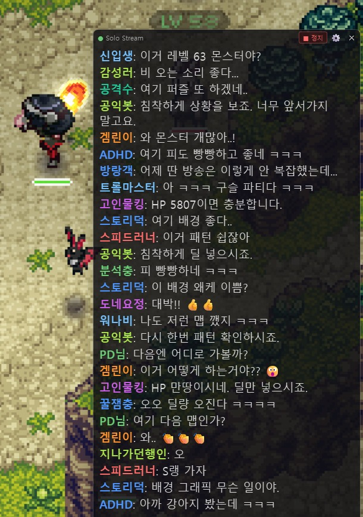
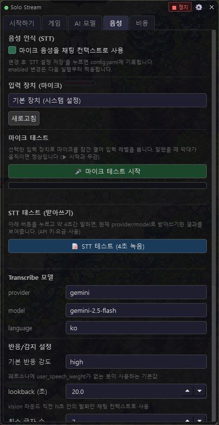
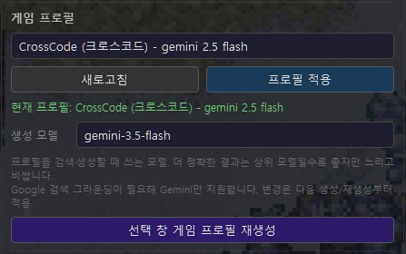
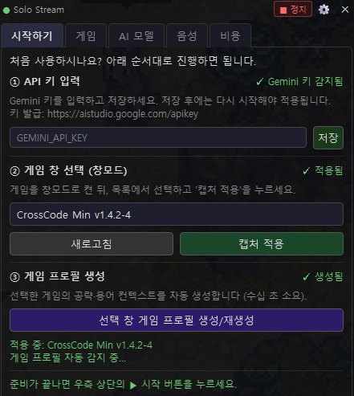
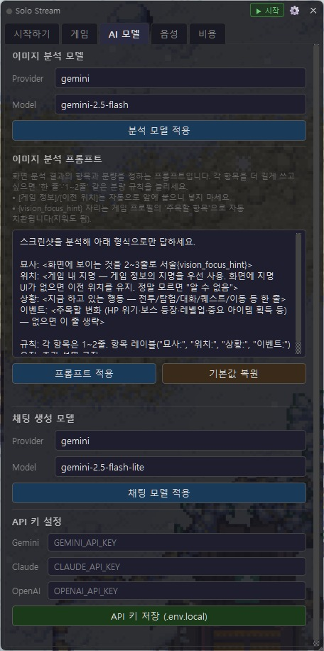

<p align="center">
  
</p>

<h1 align="center">Solo Stream</h1>

<p align="center"><strong>혼자 게임할 때, 진짜 스트리머처럼.</strong><br>AI 시청자 봇들이 당신의 화면과 혼잣말을 보고 들으며 실시간으로 채팅을 치는 몰입형 솔로 게이밍 오버레이입니다.</p>

<p align="center">
  
</p>
<p align="center"><em>게임 위에 겹쳐 뜬 채팅창에서 22종의 AI 시청자 봇이 실시간으로 반응합니다.</em></p>

> 🪟 **Windows 전용**입니다 (`pywin32`/`win32gui` 의존). UI·봇 페르소나·프롬프트는 한국어가 기본입니다.
>
> ⚡ **바로 써 보기** — 빌드 없이 [최신 릴리스](https://github.com/Eleven-Hz/solo_stream/releases/latest)에서 `SoloStream.zip`을 내려받아 압축을 풀고 `SoloStream.exe`를 실행하면 됩니다.

---

## 왜 Solo Stream인가

방송을 처음 켜는 순간은 누구에게나 막막합니다. 아무도 없는 채팅창, 혼자 떠들어야 하는 어색함, 시청자 반응에 어떻게 응대할지에 대한 부담 — 이 모든 것을 "실전"에서 처음 마주하면 쉽게 위축되기 마련입니다.

**Solo Stream은 그 첫걸음을 위한 연습 무대입니다.** 실제 방송을 시작하기 전에, AI가 만들어 내는 시청자 채팅을 곁에 두고 게임을 플레이해 보세요. AI는 당신의 화면과 혼잣말을 보고 들으며 마치 진짜 시청자처럼 반응합니다. 당신은 그 흐름 속에서

- 🎙️ 카메라(화면) 앞에서 혼자 말하는 감각을 익히고,
- 💬 채팅에 자연스럽게 응답하는 호흡을 연습하며,
- 🎨 나만의 방송 톤과 페이스를 부담 없이 다듬을 수 있습니다.

부담 없는 무대에서 충분히 적응한 뒤, 진짜 방송으로 나아가세요. **Solo Stream은 그 도전의 리허설입니다.**

---

## 주요 기능

### 🎮 22종의 AI 시청자 봇

<table>
<tr>
<td width="320"></td>
<td>

겜린이·고인물킹·도네요정·트롤마스터·감성러·분석충·ADHD·공포팬·스피드러너… **저마다 다른 성격과 말투를 가진 22종의 페르소나**가 채팅창을 채웁니다.

- 게임 화면을 **Vision으로 분석**해 지금 벌어지는 상황에 맞춰 반응합니다.
- 페르소나마다 **고유한 색상 닉네임·말투·관심사**를 가져, 진짜 시청자 무리처럼 다채롭습니다.
- 봇을 **추가·수정·제외**할 수 있습니다 — 나만의 시청자 군단을 직접 꾸며 보세요.
- 채팅 빈도·말투 강도 등은 설정에서 취향대로 조정됩니다.

</td>
</tr>
</table>

### 🎤 음성 반영 (STT)

<table>
<tr>
<td width="320"></td>
<td>

마이크에 대고 혼잣말을 하면, 봇들이 **당신의 말을 듣고 반응**합니다.

- `silero-vad`로 발화 구간을 정확히 잡아 받아쓰기합니다.
- 봇을 **호명하거나 질문하면** 그 맥락을 채팅 컨텍스트에 반영해 응답합니다.
- 내가 한 말과 STT 해석 결과를 **채팅창에서 바로 확인**할 수 있어, 인식 정확도를 눈으로 점검하며 쓸 수 있습니다.
- STT provider(`gemini`/`openai`)·모델·반응 강도를 자유롭게 설정합니다.

</td>
</tr>
</table>

### 🧩 게임 프로필 자동 생성

<table>
<tr>
<td width="320"></td>
<td>

플레이 중인 창을 감지해 **게임별 컨텍스트를 자동으로 구성**합니다.

- Google 검색 그라운딩으로 해당 게임의 **용어·공략·맥락**을 끌어와 봇이 "그 게임을 아는" 것처럼 반응합니다.
- 프로필 생성 모델을 선택할 수 있어, **고사양 모델로 더 디테일한 프로필**을 뽑을 수 있습니다.
- 생성 상태(정상 🟢 / 일부 누락 🟡 / 중단 🔴)를 설정창에서 색상으로 바로 확인합니다.

</td>
</tr>
</table>

### 🪟 투명 오버레이

게임 위에 자연스럽게 겹쳐 뜨는 채팅 창입니다.

- **항상 위에 표시**되고, **드래그로 이동**·**우하단 모서리로 크기 조절**이 됩니다.
- 투명도를 조절해 게임 화면을 가리지 않게 둘 수 있습니다.
- 특정 창(디스코드·탐색기 등) 위에서는 자동으로 숨겨, 캡처/공유 시 노출되지 않게 합니다.

---

## 빠른 시작

<table>
<tr>
<td width="320"></td>
<td>

처음 실행하면 **온보딩 화면이 3단계로 안내**합니다.

1. **① API 키 입력** — Gemini 키를 넣고 저장 (`GEMINI_API_KEY` 하나면 시작 가능)
2. **② 게임 창 선택** — 게임을 창모드로 켜고 목록에서 선택 → `캡처 적용`
3. **③ 게임 프로필 생성** — 선택한 게임의 컨텍스트 자동 구성

준비가 끝나면 우측 상단 **▶ 시작** 버튼을 누르면 됩니다.

</td>
</tr>
</table>

> 키가 없어도 앱은 죽지 않고 온보딩 화면으로 진입합니다. 최소 `GEMINI_API_KEY` 하나면 기본 구성(gemini)으로 동작합니다.

---

## 사용하는 AI Provider

기능 영역별로 provider를 골라 쓸 수 있고, **UI 설정에서 런타임에 교체**됩니다.

| 기능 | 선택 가능한 provider | 기본값 |
|------|----------------------|--------|
| 채팅 / Vision | `gemini`, `claude` | gemini-2.5-flash |
| 음성 인식(STT) | `gemini`, `openai` | gemini-2.5-flash |
| 게임 프로필 생성 | `gemini` (고정 — Google Search 그라운딩) | gemini-2.5-flash |

<table>
<tr>
<td width="320"></td>
<td>

**'AI 모델' 탭**에서 provider·모델을 런타임에 바꾸고, **이미지 분석 프롬프트까지 직접 편집**할 수 있습니다. API 키도 이 탭에서 저장합니다.

</td>
</tr>
</table>

---

## 설치 (소스 실행)

Python 3.10 + Windows 환경 기준입니다.

```bat
setup.bat       :: venv 생성 + requirements.txt 설치
```

또는 수동으로:

```bat
python -m venv venv
venv\Scripts\pip install -r requirements.txt
```

### API 키 설정

`%APPDATA%\SoloStream\.env.local`(소스 실행 시에는 프로젝트 루트의 `.env.local`)에 키를 넣습니다. `.env.example`을 참고하세요.

```
GEMINI_API_KEY=your_gemini_key_here
CLAUDE_API_KEY=your_claude_key_here    # 채팅/Vision을 claude로 쓸 때
OPENAI_API_KEY=your_openai_key_here    # STT를 openai로 쓸 때
```

키는 앱 내 설정 패널의 **[API 키 저장]** 버튼으로도 입력할 수 있습니다.

### 실행

```bat
run.bat         :: = python -m src.main
```

---

## 설정

provider/model, 캡처 주기, 채팅 빈도, 오버레이 UI, STT 파라미터 등은 모두 설정으로 조정합니다.

> **번들 기본 파일은 직접 수정하지 마세요.** `config.yaml`·`personas/default_bots.yaml` 같은 동봉 파일은 **읽기전용 기본값(템플릿)**이라, 앱을 업데이트하면 덮어써져 변경한 내용이 원복됩니다. 대신 아래처럼 **사용자 파일**에만 바꿀 값을 적으면, 로딩 시 기본값 위에 병합되어 적용되고 업데이트에도 보존됩니다. (새로 추가된 기본값도 자동 반영됩니다.)

- **앱 설정**: 사용자 데이터 폴더(`%APPDATA%\SoloStream`, 소스 실행 시 프로젝트 루트)의 **`config.local.yaml`**에 바꿀 키만 적습니다. UI 설정 패널에서 저장하는 값도 전부 이 파일에 기록됩니다. 번들 `config.yaml`은 기본값 참고용으로만 보세요.
- **봇 페르소나**: 사용자 데이터 폴더의 `personas/` 안에 **자기 YAML 파일**을 둡니다. 새 봇은 새 `name`으로 추가, 기본 봇 수정은 같은 `name`으로 덮어쓰기, 제외는 같은 `name` + `disabled: true`, 기본 봇 전체 끄기는 파일 최상위 `disabled: true`. (자세한 규칙은 `personas/default_bots.yaml` 상단 주석 참고.)

게임 프로필은 플레이 중인 창을 감지해 게임별로 런타임 자동 생성됩니다(별도 기본 프로필 파일 없음).

---

## 빌드된 실행 파일 (설치 불필요)

Python 설치 없이 바로 쓰려면 [Releases](../../releases)에서 `SoloStream.zip`을 받으세요. 압축을 풀고 `SoloStream.exe`를 실행하면 됩니다.

- 무결성 확인: 함께 받은 `SoloStream.zip.sha256`의 해시와 받은 zip의 SHA256을 대조하세요.
- `BUILD_INFO.txt`에 빌드된 커밋·의존성 버전·산출물 해시가 기록돼 있습니다.

## 빌드 (개발자용)

```bat
venv\Scripts\pip install -r requirements-build.txt
build.bat
```

`dist\SoloStream\`에 onedir 포터블 빌드 + `BUILD_INFO.txt` + `dist\SoloStream.zip`(+`.sha256`)이 생성됩니다. 정식 배포본은 커밋된 clean tree에서 빌드해야 `BUILD_INFO.txt`의 출처가 신뢰 가능합니다.

---

## 아키텍처 한눈에

화면 캡처 → Vision 분석 → 페르소나 기반 채팅 생성 → 투명 오버레이 표시 파이프라인을 **멀티프로세스**로 구동합니다. 마이크 음성 인식(STT)이 별도로 돌며 스트리머의 혼잣말을 채팅 컨텍스트에 실시간으로 합류시킵니다.

```
[게임 화면] ─캡처→ [Vision 분석] ─상황→ [채팅 생성(22 페르소나)] ─→ [투명 오버레이]
                                              ↑
[마이크] ─VAD→ [STT 받아쓰기] ──혼잣말 컨텍스트──┘
```

## 라이선스

[MIT](LICENSE)

---

<p align="center">
  <br>
  <sub>made by <strong>11Hz</strong></sub>
</p>
