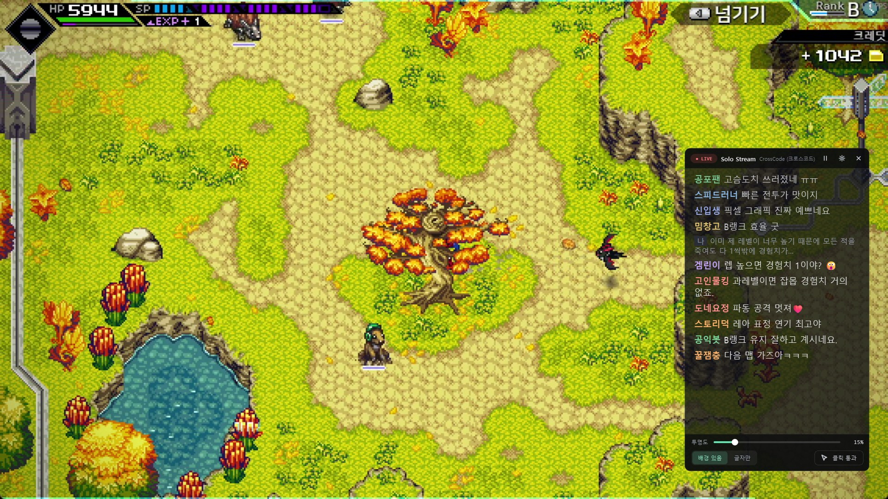
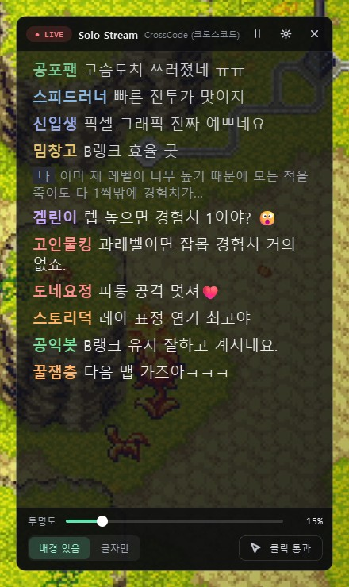
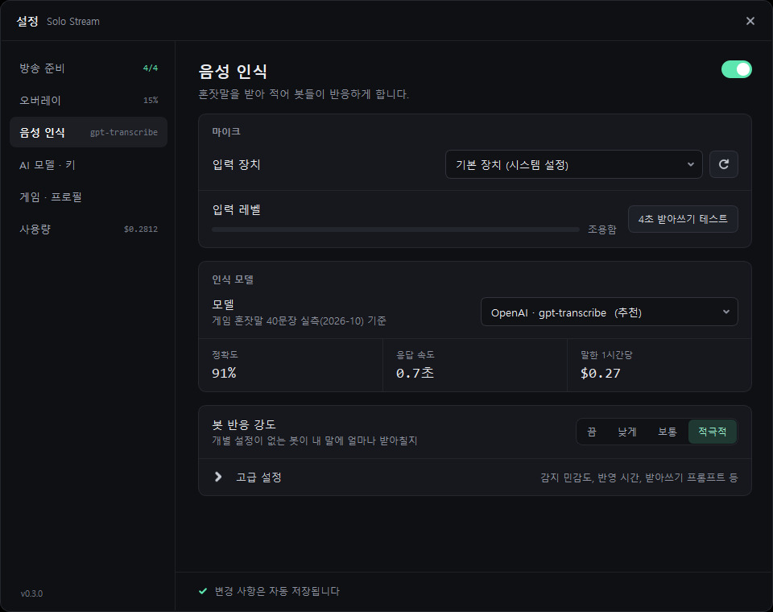
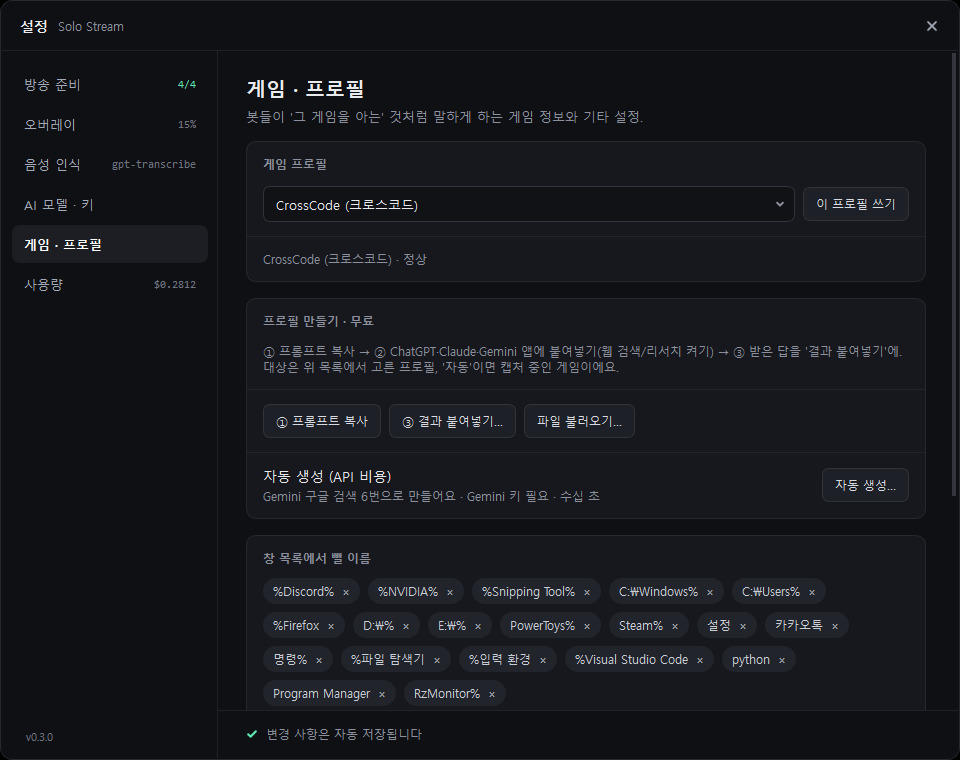
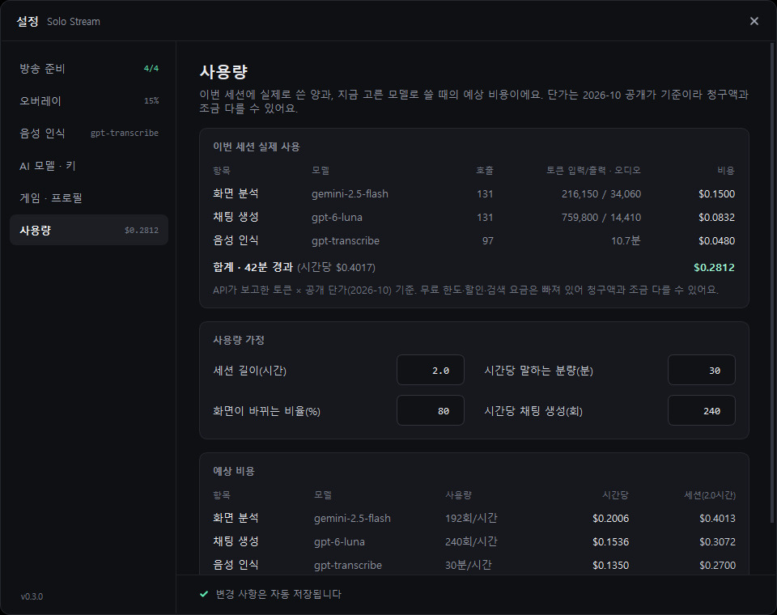
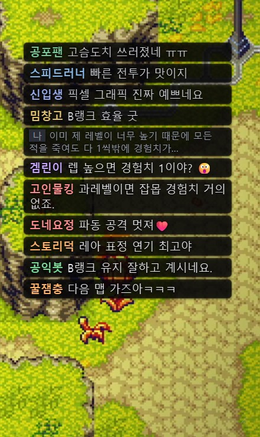
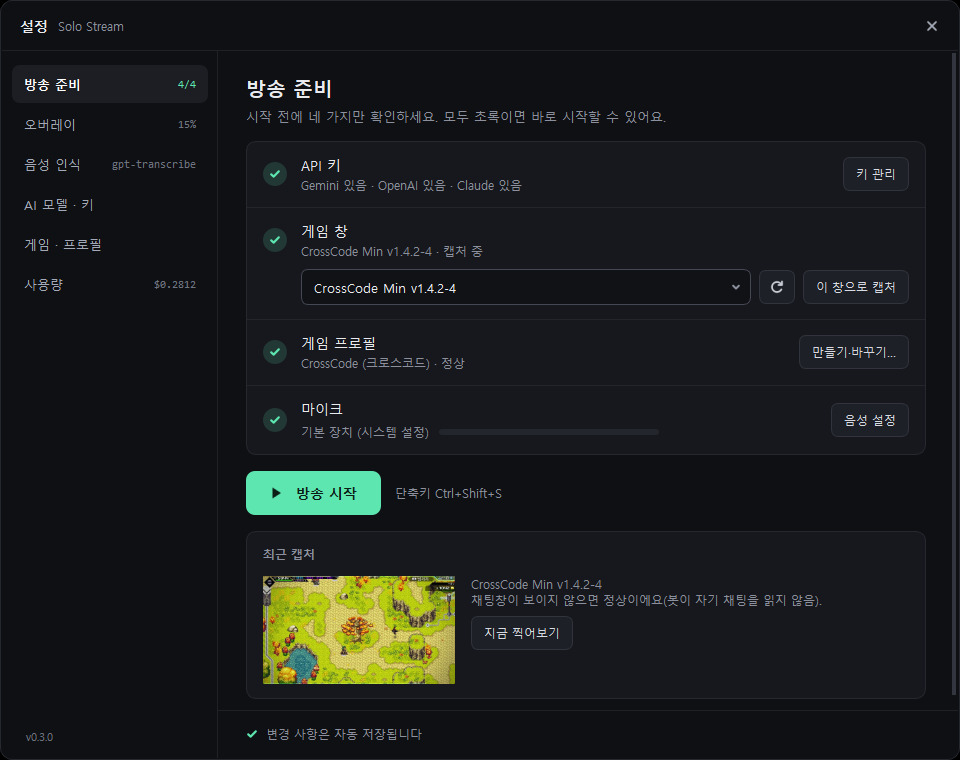
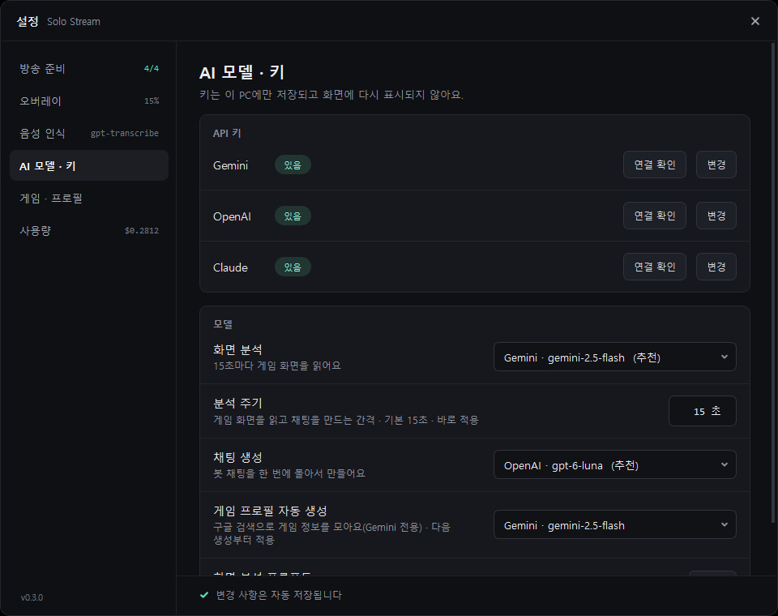

<p align="center">
  
</p>

<h1 align="center">Solo Stream</h1>

<p align="center"><strong>혼자 게임할 때, 진짜 스트리머처럼.</strong><br>AI 시청자 봇들이 당신의 화면과 혼잣말을 보고 들으며 실시간으로 채팅을 치는 몰입형 솔로 게이밍 오버레이입니다.</p>

<p align="center">
  
</p>
<p align="center"><em>게임 위에 겹쳐 뜬 채팅창에서 22종의 AI 시청자 봇이 화면과 내 혼잣말(회색 <code>나</code> 줄)에 실시간으로 반응합니다.</em></p>

> 🪟 **Windows 전용**입니다 (`pywin32`/`win32gui` 의존). UI·봇 페르소나·프롬프트는 한국어가 기본입니다.
>
> ⚡ **바로 써 보기** — 빌드 없이 [최신 릴리스](https://github.com/Eleven-Hz/solo_stream/releases/latest)에서 `SoloStream.zip`을 내려받아 압축을 풀고 `SoloStream.exe`를 실행하면 됩니다.

---

## 왜 Solo Stream인가

방송을 처음 켜는 순간은 누구에게나 막막합니다. 아무도 없는 채팅창, 혼자 떠들어야 하는 어색함, 시청자 반응에 어떻게 응대할지에 대한 부담 — 이 모든 것을 "실전"에서 처음 마주하면 쉽게 위축되기 마련입니다.

**Solo Stream은 그 첫걸음을 위한 연습 무대입니다.** 실제 방송을 시작하기 전에, AI가 만들어 내는 시청자 채팅을 곁에 두고 게임을 플레이해 보세요. AI는 당신의 화면과 혼잣말을 보고 들으며 마치 진짜 시청자처럼 반응합니다. 당신은 그 흐름 속에서

- 🎙️ 카메라(화면) 앞에서 혼자 말하는 감각을 익히고,
- 💬 채팅에 자연스럽게 응답하는 호흡을 연습하며,
- 🎨 나만의 방송 톤과 페이스를 부담 없이 다듬을 수 있습니다.

부담 없는 무대에서 충분히 적응한 뒤, 진짜 방송으로 나아가세요. **Solo Stream은 그 도전의 리허설입니다.**

---

## 주요 기능

### 🎮 22종의 AI 시청자 봇

<table>
<tr>
<td width="320"></td>
<td>

겜린이·고인물킹·도네요정·트롤마스터·감성러·분석충·공포팬·스피드러너… **저마다 다른 성격과 말투를 가진 22종의 페르소나**가 채팅창을 채웁니다.

- 게임 화면을 **AI가 읽고**, 지금 벌어지는 상황에 맞춰 반응합니다.
- 페르소나마다 **고유한 색상 닉네임·말투·관심사**를 가져, 진짜 시청자 무리처럼 다채롭습니다.
- 같은 소재에 봇이 몰리거나("렉…" 도배) 직전 말을 복붙하는 것을 걸러, 채팅이 단조로워지지 않게 합니다.
- 봇을 **추가·수정·제외**할 수 있습니다 — 나만의 시청자 군단을 직접 꾸며 보세요.

</td>
</tr>
</table>

### 🎤 음성 반영 (STT)

<table>
<tr>
<td width="320"></td>
<td>

마이크에 대고 혼잣말을 하면, 봇들이 **당신의 말을 듣고 반응**합니다. 받아쓴 내 말은 채팅창에 회색 `나` 줄로 보여 줄 수 있습니다.

- `silero-vad`로 말하는 구간만 잘라 받아쓰기합니다. 기본 모델 **gpt-transcribe**는 게임 혼잣말 40문장 실측 **정확도 91%**.
- 봇을 **호명하거나 질문하면** 그 봇이 답합니다.
- 4초 **받아쓰기 테스트**로 마이크·인식 품질을 바로 확인할 수 있습니다.
- 봇 반응 강도(끔/낮게/보통/적극적)와 감지 민감도 등을 조절합니다.

</td>
</tr>
</table>

### 🧩 게임 프로필 — 구독 중인 AI 채팅으로 무료 생성

<table>
<tr>
<td width="320"></td>
<td>

게임별 **용어·지역·보스·커뮤니티 밈**을 담은 프로필이 있으면 봇이 "그 게임을 아는" 것처럼 말합니다.

1. **① 프롬프트 복사** — 게임 이름이 들어간 프롬프트가 복사됩니다.
2. ChatGPT·Claude·Gemini 앱에 붙여넣습니다(웹 검색/리서치 켜기).
3. **③ 결과 붙여넣기** — 받은 답을 그대로 붙여넣으면 항목을 읽어 미리 보여주고 저장합니다.

API 비용 없이 구독 채팅의 검색으로 만들 수 있습니다. Gemini 키가 있으면 **자동 생성(구글 검색, API 비용)** 버튼도 쓸 수 있습니다. 프로필이 없어도 화면만 보고 채팅합니다.

</td>
</tr>
</table>

### 💸 실시간 사용량 · 비용

<table>
<tr>
<td width="320"></td>
<td>

AI가 알려준 **실제 토큰 수**로 이번 세션에 쓴 금액을 실시간으로 보여줍니다.

- 항목(화면 분석·채팅·음성 인식·게임 프로필)·모델별 호출 수, 토큰, 비용
- 경과 시간과 시간당 환산, 지금 고른 모델로 쓸 때의 **예상 비용**
- **분석 주기**(기본 15초)를 줄이면 채팅이 더 자주 올라오는 대신 비용이 늘어, 설정에서 예상 금액과 함께 경고합니다.

</td>
</tr>
</table>

### 🪟 투명 오버레이

<table>
<tr>
<td width="320"></td>
<td>

게임 위에 겹쳐 뜨는 채팅창입니다.

- **항상 위에 표시**, 드래그로 이동, 모서리로 크기 조절.
- **투명도** 슬라이더와 **배경 있음 / 글자만** 전환 — 글자만 모드는 줄마다 옅은 받침이 깔려 밝은 화면에서도 읽힙니다.
- **클릭 통과** — 채팅창 위 클릭을 게임으로 넘깁니다. `Ctrl+Shift+O`로 켜고 끕니다.
- **화면 분석에서 채팅창 숨기기** — 봇이 자기 채팅을 화면으로 다시 읽지 않게 캡처에서 오버레이를 뺍니다.
- `Ctrl+Shift+S`로 방송 시작/정지.

</td>
</tr>
</table>

---

## 빠른 시작

<table>
<tr>
<td width="320"></td>
<td>

설정 창의 **방송 준비** 화면에서 네 가지가 모두 초록이면 시작할 수 있습니다.

1. **API 키** — Gemini·OpenAI·Claude 중 **하나 이상** ([키 관리] → 'AI 모델 · 키')
2. **게임 창** — 게임을 창 모드로 켜고 목록에서 고른 뒤 `이 창으로 캡처`
3. **게임 프로필** — 있으면 자동으로 불러오고, 없으면 `만들기·바꾸기…`
4. **마이크** — 음성 인식을 쓸 때만 (말해 보면 레벨이 움직입니다)

준비가 끝나면 **▶ 방송 시작**(또는 `Ctrl+Shift+S`).

</td>
</tr>
</table>

> 처음 실행했는데 키가 없으면 앱은 죽지 않고 'AI 모델 · 키' 화면을 먼저 엽니다. 무료로 시작하려면 Gemini 키(무료 등급)를 권장합니다.

---

## 사용하는 AI

기능마다 provider·모델을 골라 쓸 수 있고, **설정에서 바꾸면 바로 적용**됩니다.

| 기능 | 고를 수 있는 provider | 기본값 |
|------|----------------------|--------|
| 화면 분석 | `gemini`, `openai`, `claude` | gemini-2.5-flash |
| 채팅 생성 | `openai`, `gemini`, `claude` | gpt-6-luna |
| 음성 인식(STT) | `openai`, `gemini` | gpt-transcribe |
| 게임 프로필 | 구독 채팅에 프롬프트 붙여넣기(무료) / `gemini` 자동 생성(Google Search) | — |

<table>
<tr>
<td width="320"></td>
<td>

**'AI 모델 · 키'** 화면에서 키를 저장하고, 화면 분석·채팅 모델과 분석 주기를 고르고, 화면 분석 프롬프트까지 직접 고칠 수 있습니다.

- **키는 하나만 있어도 됩니다.** 고른 모델의 키가 없으면 가지고 있는 키의 모델로 대신 돌고, 그 모델 칸에 "⚠ 키가 없어요 — ○○로 대체돼요"가 표시됩니다.
- 채팅 기본값 gpt-6-luna는 샘플 영상 비교에서 스트리머 말에 가장 잘 반응했고, 비용은 gemini-2.5-flash-lite와 비슷합니다.

</td>
</tr>
</table>

---

## 설치 (소스 실행)

Python 3.10 + Windows 환경 기준입니다.

```bat
setup.bat       :: venv 생성 + requirements.txt 설치
```

또는 수동으로:

```bat
python -m venv venv
venv\Scripts\pip install -r requirements.txt
```

### API 키 설정

앱의 **'AI 모델 · 키'** 화면에서 [추가] → 붙여넣기 → [저장] 후 다시 시작하면 됩니다. 키는 `%APPDATA%\SoloStream\.env.local`(소스 실행 시 `SOLO_STREAM_DEV=1`이면 프로젝트 루트의 `.env.local`)에 저장되며, 파일에 직접 적어도 됩니다(`.env.example` 참고). **셋 중 하나 이상**이면 동작합니다.

```
GEMINI_API_KEY=your_gemini_key_here    # 무료 등급으로 시작 가능
OPENAI_API_KEY=your_openai_key_here    # 채팅 기본(gpt-6-luna)·음성 인식 기본(gpt-transcribe)
CLAUDE_API_KEY=your_claude_key_here    # 화면 분석·채팅을 claude로 쓸 때
```

### 실행

```bat
run.bat         :: = python -m src.main
```

---

## 설정

모델, 분석 주기, 오버레이, 음성 인식 등은 모두 설정 창에서 바꾸며 바로 저장됩니다.

> **번들 기본 파일은 직접 수정하지 마세요.** `config.yaml`·`personas/default_bots.yaml` 같은 동봉 파일은 **읽기전용 기본값(템플릿)**이라, 앱을 업데이트하면 덮어써져 변경한 내용이 원복됩니다. 대신 아래처럼 **사용자 파일**에만 바꿀 값을 적으면, 로딩 시 기본값 위에 병합되어 적용되고 업데이트에도 보존됩니다. (새로 추가된 기본값도 자동 반영됩니다.)

- **앱 설정**: 사용자 데이터 폴더(`%APPDATA%\SoloStream`)의 **`config.local.yaml`**에 바꿀 키만 적습니다. 설정 창에서 바꾼 값도 전부 이 파일에 기록됩니다. 번들 `config.yaml`은 기본값 참고용으로만 보세요.
- **봇 페르소나**: 사용자 데이터 폴더의 `personas/` 안에 **자기 YAML 파일**을 둡니다. 새 봇은 새 `name`으로 추가, 기본 봇 수정은 같은 `name`으로 덮어쓰기, 제외는 같은 `name` + `disabled: true`, 기본 봇 전체 끄기는 파일 최상위 `disabled: true`. (자세한 규칙은 `personas/default_bots.yaml` 상단 주석 참고.)
- **게임 프로필**: 사용자 데이터 폴더의 `game_profiles/`에 게임별 YAML로 저장됩니다. 직접 고쳐도 됩니다.

---

## 빌드된 실행 파일 (설치 불필요)

Python 설치 없이 바로 쓰려면 [Releases](../../releases)에서 `SoloStream.zip`을 받으세요. 압축을 풀고 `SoloStream.exe`를 실행하면 됩니다.

- 무결성 확인: 함께 받은 `SoloStream.zip.sha256`의 해시와 받은 zip의 SHA256을 대조하세요.
- `BUILD_INFO.txt`에 빌드된 커밋·의존성 버전·산출물 해시가 기록돼 있습니다.

## 빌드 (개발자용)

```bat
venv\Scripts\pip install -r requirements-build.txt
build.bat
```

`dist\SoloStream\`에 onedir 포터블 빌드 + `BUILD_INFO.txt` + `dist\SoloStream.zip`(+`.sha256`)이 생성됩니다. 정식 배포본은 커밋된 clean tree에서 빌드해야 `BUILD_INFO.txt`의 출처가 신뢰 가능합니다.

---

## 아키텍처 한눈에

화면 캡처 → 화면 분석(Vision) → 페르소나 기반 채팅 생성 → 투명 오버레이 표시 파이프라인을 **멀티프로세스**로 구동합니다. 마이크 음성 인식(STT)이 별도로 돌며 스트리머의 혼잣말을 채팅 컨텍스트에 실시간으로 합류시킵니다.

```
[게임 화면] ─캡처→ [Vision 분석] ─상황→ [채팅 생성(22 페르소나)] ─→ [투명 오버레이]
                                              ↑
[마이크] ─VAD→ [STT 받아쓰기] ──혼잣말 컨텍스트──┘
```

## 라이선스

[MIT](LICENSE)

---

<p align="center">
  <br>
  <sub>made by <strong>11Hz</strong></sub>
</p>
